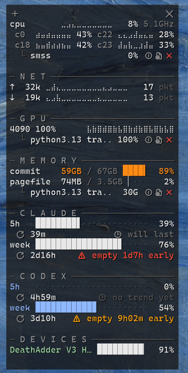
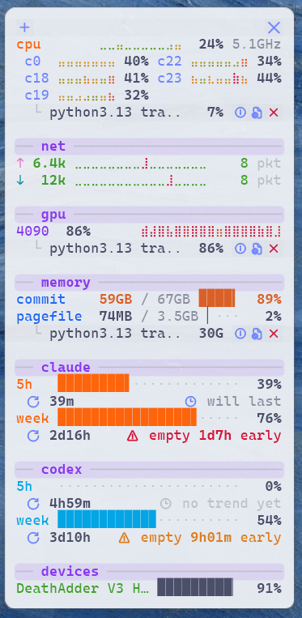
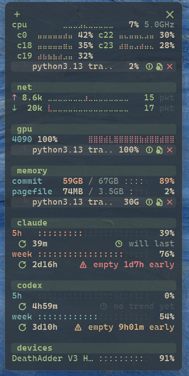
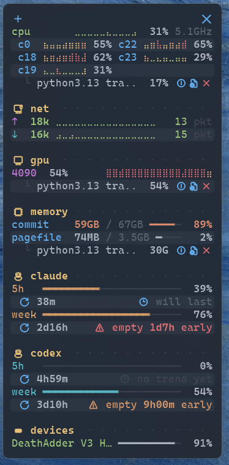
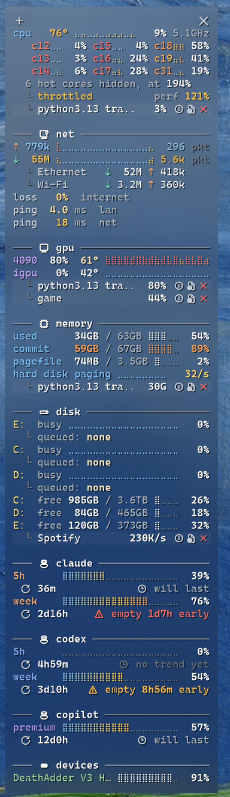
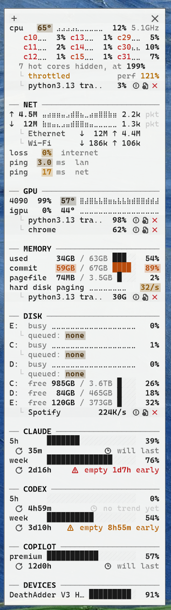

# Ember

A small, text-only desktop widget for Windows. It shows only what needs attention — CPU, GPU, memory, disk, network, Claude / Codex / Copilot usage limits, device batteries — in a compact btop-like style. It also has markdown sticky notes.

<p>



</p>
<p>



</p>

## Install

1. Download the exe or zip from [Releases](../../releases).
2. In an **admin** PowerShell, in the folder with the files:

   ```powershell
   powershell -ExecutionPolicy Bypass -File .\install.ps1
   ```

   This installs to `%LOCALAPPDATA%\Ember` and starts Ember at logon (with admin rights, without a UAC prompt).
3. To remove: `.\uninstall.ps1` (as admin; add `-RemoveData` to also delete settings and notes).

You can also just run `Ember.exe`.

## Requirements

- Windows 10 or 11, x64.
- **CPU temperatures need admin rights** (start Ember elevated, or install as above). Some antivirus tools flag the temperature driver; without it, temperatures stay hidden.
- **Claude usage:** Claude Code logged in.
- **Codex usage:** the Codex CLI logged in with a ChatGPT plan.
- **Copilot usage:** a Copilot plugin for JetBrains, Vim/Neovim or Visual Studio, or the GitHub CLI logged in (`gh auth login`). The VS Code extension alone is not enough.
- **Device batteries:** Bluetooth devices that show their battery in Windows Settings, and Razer HyperSpeed receivers.

Ember only reads the usage tokens; it never refreshes them. The usage endpoints are not documented and can change.

## Use

- **Tray icon:** show/hide the widget, new note, edit layout, show everything, settings, open log.
- **Top row:** drag to move; right-click for the menu.
- **Process lines:** click for details (copyable); icons for file properties and end process; right-click for more.
- **Hover** a line or button for details (for example the time when a usage limit runs out).
- **Show everything** (tray): all lines with sample data, to try themes and layouts.
- **Settings:** layout (order, on/off, headers), 20 themes, backgrounds, colours, thresholds, intervals, network options. Themes and layouts can be imported and exported as JSON ([examples](presets/)).
- **Notes:** tray, toolbar **+**, or **Ctrl+Alt+N**. Markdown is styled as you type. Ctrl+click opens links.

Settings, notes and the log are in `%APPDATA%\Ember` (Settings → General → Open data folder). For a problem, turn on Settings → General → Debug log and open the log from the tray.

## Build

.NET 10 SDK:

```powershell
dotnet build Ember.slnx -c Release
dotnet test tests/Ember.Tests
dotnet publish src/Ember/Ember.csproj -c Release -r win-x64 -o publish
```

A new `<Version>` in `src/Ember/Ember.csproj` on `main` creates a GitHub release (notes from `docs/releases/<tag>.md`). Design choices: [docs/decisions.md](docs/decisions.md).

## Not tested

Ember was written on Linux. The tests and the Windows build run in CI, but these parts have not been checked on a real Windows machine: window behaviour and backgrounds, text drawing, mouse handling, DPI changes, sensor values, process actions, usage requests with real tokens, device batteries, network pings, the note editor, the settings window, the install scripts, sleep/lock/Explorer restarts, and resource use.
